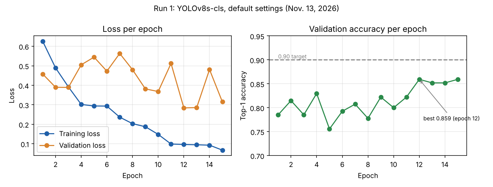

# Coral Bleaching Detection with Transfer Learning

CPECOG2 (Deep Neural Networks) design project, Group 2.

The project classifies underwater reef photographs as **healthy** or **bleached** coral with a small pretrained CNN (YOLOv8s-cls), so that bleaching can be screened faster than by manual photo review.

## Targets

| Metric | Target |
| :-- | :-- |
| Macro F1 (held-out test set) | 0.90 or higher |
| Bleached-class recall | 0.90 or higher |
| Model size | under 50 MB |
| CPU latency | under 200 ms per image |

## Data

- **Primary:** [Healthy and Bleached Corals Image Classification](https://www.kaggle.com/datasets/vencerlanz09/healthy-and-bleached-corals-image-classification) (Kaggle), 923 images (485 bleached, 438 healthy).
- **External test set:** healthy and bleached BHD and BU images from [Coral Health Classification](https://huggingface.co/datasets/esahit/coral-health-classification) (Hugging Face).

Images are not stored in this repository. The notebook downloads them with `kagglehub`. The fixed split (after removing 21 perceptual-hash duplicates) is in [`data/splits.csv`](data/splits.csv): 631 train, 135 validation, 136 test, stratified 70/15/15 with seed 42.

## Repository layout

```
notebooks/Group2_Coral_Run1.ipynb   download, EDA, de-duplication, split, Run 1 training and evaluation
data/splits.csv                      file name, label, split, perceptual hash for every image used
results/run1/                        Run 1 metrics, confusion matrix, training curves, summary
requirements.txt                     pinned library versions
```

## How to run

1. Open `notebooks/Group2_Coral_Run1.ipynb` in Google Colab.
2. Runtime > Change runtime type > T4 GPU.
3. Runtime > Run all (about 10 minutes).

## Results so far

| Run | Model | Settings | Val accuracy | Val macro F1 | Bleached recall | Size | CPU latency |
| :-- | :-- | :-- | :-- | :-- | :-- | :-- | :-- |
| 1 (Nov. 13, 2026) | YOLOv8s-cls, ImageNet weights | Ultralytics defaults, 15 epochs, imgsz 224, batch 32, seed 42 | 0.859 | 0.859 | 0.847 | 10.3 MB | 28 ms |



The test set has not been used; it is evaluated once after tuning is final.

## Next steps

- Review and remove the 9 duplicate groups whose copies carry conflicting labels, then re-split.
- Train the scratch CNN baseline on the same split.
- Log validation macro F1 each epoch and keep the best checkpoint by macro F1.
- Tune frozen layers, dropout and weight decay, augmentation level, and learning rate.
- Train EfficientNet-B0 on the same split as the comparison model.
