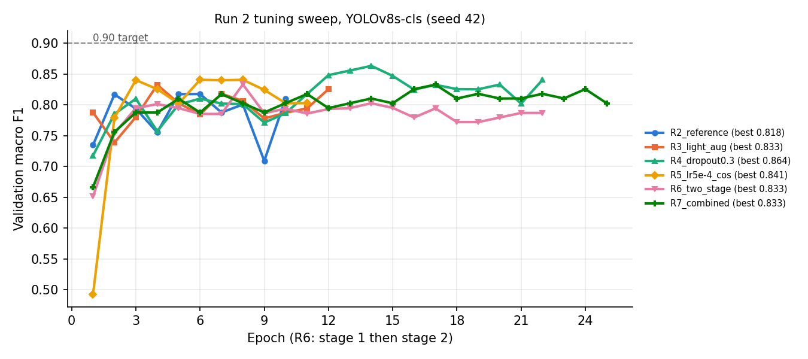
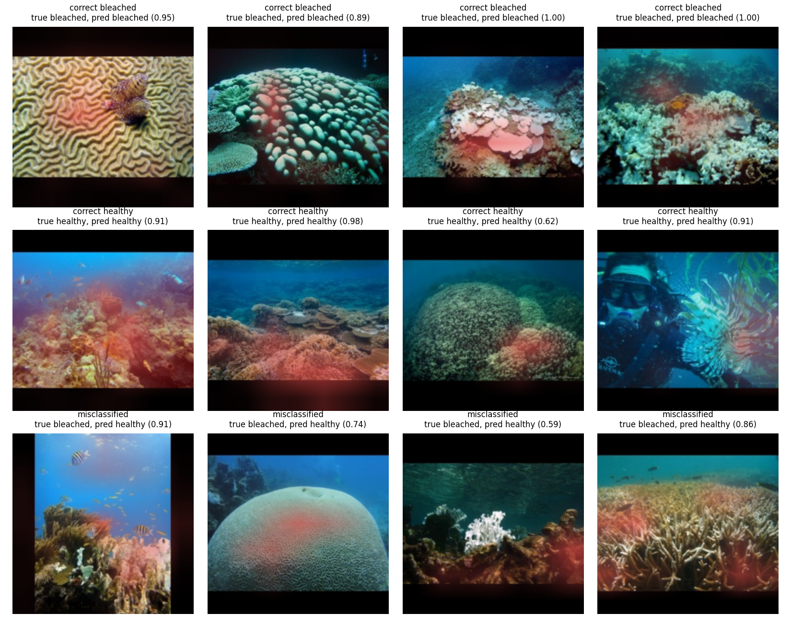

# Coral Bleaching Detection with Transfer Learning

CPECOG2 (Deep Neural Networks) design project, Group 2.

The project classifies underwater reef photographs as **healthy** or **bleached** coral with a small pretrained CNN (YOLOv8s-cls), so that bleaching can be screened faster than by manual photo review.

## Targets

| Metric | Target |
| :-- | :-- |
| Macro F1 (held-out test set) | 0.90 or higher |
| Bleached-class recall | 0.90 or higher |
| Model size | under 50 MB |
| CPU latency | under 200 ms per image |

## Data

- **Primary:** [Healthy and Bleached Corals Image Classification](https://www.kaggle.com/datasets/vencerlanz09/healthy-and-bleached-corals-image-classification) (Kaggle), 923 images (485 bleached, 438 healthy).
- **External test set:** healthy and bleached BHD and BU images from [Coral Health Classification](https://huggingface.co/datasets/esahit/coral-health-classification) (Hugging Face).

Images are not stored in this repository. The notebook downloads them with `kagglehub`. The fixed split (after removing 21 perceptual-hash duplicates) is in [`data/splits.csv`](data/splits.csv): 631 train, 135 validation, 136 test, stratified 70/15/15 with seed 42.

## Repository layout

```
notebooks/Group2_Coral_Run1.ipynb   download, EDA, de-duplication, split, Run 1 training and evaluation
notebooks/Group2_Coral_Run2.ipynb   data fixes, baselines, tuning sweep, EfficientNet-B0, final model (3 seeds),
                                     test and external evaluation, size and latency, Grad-CAM
notebooks/Group2_Coral_Run3.ipynb   leakage-safe validation-threshold experiment; outputs are kept separate
notebooks/Group2_Coral_Run4.ipynb   batch size, weight decay and model scale (validation only)
app.py                               GUI: drag in a photo -> class, P(bleached), Grad-CAM heatmap (runs locally)
get_demo_photos.py                   copy the held-out test photos (never trained on) into demo_photos/ for the demo
survey.py                            survey summary: folder of photos -> share flagged bleached per site (95% CI), review-first list
demo.py                              demo: one image or a folder -> class, probability, Grad-CAM heatmap
eval_external.py                     external BU + BHD evaluation of the final model
data/splits.csv                      file name, label, split, perceptual hash for every image used (Run 1 split)
results/run1/                        Run 1 metrics, confusion matrix, training curves, summary
results/run2/                        Run 2 outputs (unzip run2_results.zip here)
results/run3/                        Run 3 threshold-tuning outputs and final model
results/run4/                        Run 4 outputs (unzip run4_results.zip here)
requirements.txt                     library versions (exact ultralytics version)
```

## How to run

### Training and evaluation (Google Colab)

1. Open `notebooks/Group2_Coral_Run2.ipynb` in Google Colab (Run 1 is kept for the record).
2. Runtime > Change runtime type > T4 GPU.
3. Runtime > Run all (about 25 to 30 minutes). The notebook reads `data/splits.csv` from this repository's GitHub URL, so the repository must be public.
4. Download `run2_results.zip` and unzip it into `results/run2/`. It holds every table and figure, `run2_summary.txt`, the final model `final_model_s42.pt` (or `final_model_s42_effnet_b0.pt`) and its model card (`.json`, class order and preprocessing).

The held-out test set and the external BU + BHD set are evaluated once, in sections 7 and 8. Run the notebook end to end only when the tuning plan is final.

### Leakage-safe threshold tuning

Run 3 separates threshold selection from final evaluation:

1. The operating cutoff is selected only from seed-42 validation probabilities.
2. The cutoff search prefers the highest validation macro F1 among cutoffs that achieve at least 0.90 bleached recall.
3. The selected cutoff is saved in `results/run3/selected_threshold.csv`.
4. The held-out test set is evaluated once with that fixed cutoff.
5. The external BU/BHD set is evaluated once with the same validation-selected cutoff.

Pass `--threshold 0.xxx` to `eval_external.py` after selecting the cutoff. The test and external sets must not be used to change the cutoff.

### Remaining hyperparameters (Run 4)

`notebooks/Group2_Coral_Run4.ipynb` tests batch size 16, weight decay 0 and 0.001, and YOLOv8n-cls, one at a time from the final configuration (R4, dropout 0.3), on the validation set only (about 15 minutes on a T4). The test and external sets are not used, so the final model does not change. Unzip `run4_results.zip` into `results/run4/`.

### GUI (laptop CPU, no GPU or internet needed)

```
pip install -r requirements.txt
python get_demo_photos.py      # one time: copies the 131 held-out test photos into demo_photos/
python app.py
```

The browser opens at http://127.0.0.1:7860. Drop in a reef photo to see healthy or bleached, P(bleached), the decision rule, and the Grad-CAM heatmap. Everything runs on the laptop; nothing is uploaded. `demo.py` below does the same from the terminal and is the backup if the GUI has a problem.

### Survey summary: from photo checks to a site-level indicator

`demo.py` answers "is this photo bleached?". A reef monitor needs "which site needs attention, and which photos should an expert check first?". `survey.py` (and the **Survey summary** tab in `app.py`) classifies every photo from a survey and reports, per site:

- the share of photos flagged as bleached, with a 95% Wilson confidence interval so a site with few photos is not over-read;
- how many photos are uncertain (P(bleached) within 0.15 of the cutoff), which an expert should check;
- a review list of all photos, most likely bleached first.

```
python survey.py demo_photos                     # one folder = one site
python survey.py surveys/2026-11 --top 15        # each subfolder (SiteA/, SiteB/, ...) is one site
python survey.py photos --sites-csv sites.csv    # all photos in one folder; sites.csv says which site each photo is from
```

A sites CSV has two columns, `photo` (file name) and `site`, one row per photo; photos it does not list are reported as `Unassigned`. In the GUI, upload the photos and the sites CSV together in one upload to get every site at once. `python get_demo_photos.py --sites` makes a simulated 3-site example from the test photos (`demo_survey_sites.csv` and `demo_survey/`), with known bleached shares of 84%, 49% and 12%.

It writes `site_summary.csv`, `review_list.csv` and `report.md` to `survey_report/`. The rate is the share of photos flagged, not the share of coral cover bleached: it is a screening indicator for deciding where to send experts, and a trained reef monitor makes the final call.

### Demo (laptop CPU, no GPU or internet needed)

```
python demo.py path/to/photo.jpg                     # one image
python demo.py path/to/folder --csv predictions.csv  # every image in a folder
python demo.py path/to/folder --show                 # also open each heatmap in a window
python demo.py path/to/folder --benchmark            # CPU latency: 100 images, batch 1, after 10 warm-ups
```

The demo uses the newest final model it finds (`results/run3/`, then `results/run2/`), or `--weights path/to/model.pt`. A photo is called bleached when P(bleached) reaches the cutoff: the validation-selected cutoff when `selected_threshold.csv` sits next to the model (Run 3), otherwise 0.5; `--threshold` overrides it. For each image it prints the predicted class, its probability and P(bleached), and saves the photo next to a Grad-CAM overlay (red = regions that drove the prediction) in `demo_output/`. `--benchmark` is the latency test the success criteria ask for on a team laptop CPU. The model is a screening aid; a trained reef monitor makes the final call.

Supported input: JPG, PNG, BMP, WEBP or TIFF photos of coral, at least 100 px per side. Files that are not readable images are skipped with a message. Images smaller than 100 px or with almost no detail (blank or solid colour) are still classified but flagged `outside specs`, because the model was only trained on reef photos. The demo and the GUI never install packages and need no internet once `requirements.txt` is installed.

## Results so far

### Run 1 (Nov. 13, 2026): validation only

| Model | Settings | Val accuracy | Val macro F1 | Bleached recall | Size | CPU latency |
| :-- | :-- | :-- | :-- | :-- | :-- | :-- |
| YOLOv8s-cls, ImageNet weights | Ultralytics defaults, 15 epochs, imgsz 224, batch 32, seed 42 | 0.859 | 0.859 | 0.847 | 10.3 MB | 28 ms |


### Run 2 (Nov. 21, 2026): baselines, tuning, final model, test

Data: the 9 photos filed under both labels (18 files) and 1 near-duplicate across splits were removed. The final split is 629 train / 132 validation / 131 test.

Validation macro F1 (seed 42) for each candidate. The final model is the one with the highest value.

| Model / run | Val macro F1 | Val bleached recall |
| :-- | :-- | :-- |
| Majority class | 0.343 | |
| Scratch CNN (3 blocks, 0.29M params) | 0.788 | 0.754 |
| R2 YOLOv8s-cls, Run 1 settings | 0.818 | 0.826 |
| R3 light augmentation | 0.833 | 0.739 |
| **R4 dropout 0.3 (final)** | **0.864** | 0.797 |
| R5 AdamW, lr0 5e-4, cosine | 0.841 | 0.797 |
| R6 two-stage fine-tuning | 0.833 | 0.797 |
| R7 R3 to R6 combined | 0.833 | 0.754 |
| EfficientNet-B0 | 0.833 | 0.812 |

Final model on the held-out test set (n = 131, evaluated once, mean ± std over seeds 42, 43, 44):

| Metric | Target | Result | Status |
| :-- | :-- | :-- | :-- |
| Macro F1 | ≥ 0.90 | 0.839 ± 0.046 | not met |
| Bleached recall | ≥ 0.90 | 0.801 ± 0.091 | not met |
| Gain over the scratch CNN (test macro F1 0.771) | ≥ +10 points | +6.8 points | not met |
| Accuracy / ROC AUC | | 0.840 ± 0.046 / 0.921 ± 0.007 | |
| Model size | < 50 MB | 10.3 MB | met |
| CPU latency (Colab CPU) | < 200 ms | 36 ms | met |

By seed, test macro F1 was 0.793, 0.885 and 0.840. Seed 42 confusion matrix (rows true healthy/bleached, columns predicted): [[57, 7], [20, 47]]. Most errors are bleached photos predicted as healthy.



Error analysis (seed 42, [`test_errors.csv`](results/run2/test_errors.csv), [`gradcam_test.png`](results/run2/gradcam_test.png)):

- 20 of the 27 test errors are bleached photos predicted healthy. 12 of the 20 have P(bleached) below 0.35, so a slightly lower cutoff would recover only a few of them.
- Grad-CAM on correct bleached predictions falls on the pale coral, not on the water or fish.
- Missed bleached photos are mostly wide reef scenes where the bleached coral is a small part of the frame (partial bleaching), or naturally pale coral such as a brain coral. In one, the heatmap sits on dark coral next to a clearly white colony.
- Some heatmaps spread faintly onto the black padding bars.



External set: Run 2 section 8 evaluated only the BU images (n = 238: macro F1 0.768 ± 0.034, bleached recall 0.672 ± 0.081). The BHD files are named `*_hbd_*` in the Hugging Face zip, so the name check missed them. The notebook is fixed, and `eval_external.py` evaluates the final model on BU + BHD.

### Run 3 (Nov. 21, 2026): leakage-safe threshold experiment

Run 3 retrains the Run 2 final configuration, YOLOv8s-cls with dropout 0.3, and uses the same 629/132/131 split. The decision threshold was selected only on seed-42 validation probabilities, before held-out test evaluation:

| Item | Result |
| :-- | :-- |
| Validation-selected threshold | 0.1774575 |
| Validation bleached recall | 0.802 ± 0.008 |
| Held-out macro F1 | 0.819 ± 0.008 |
| Held-out bleached recall | 0.915 ± 0.031 |
| Held-out accuracy / ROC AUC | 0.822 ± 0.009 / 0.921 ± 0.007 |
| Scratch-CNN test macro F1 | 0.755 |
| Gain over scratch CNN | +6.4 points |
| Model size | 10.3 MB |
| CPU latency | 27 ms/image |

By seed, held-out macro F1 was 0.815, 0.814 and 0.829; bleached recall was 0.881, 0.925 and 0.940. Seed 42 produced a confusion matrix of [[48, 16], [8, 59]] for healthy and bleached rows/columns, with 24 errors.

External BU + BHD evaluation used 1,134 images after removing 28 within-set repeats and 7 matches with the primary dataset:

| External set | Macro F1 | Bleached recall | Accuracy |
| :-- | :-- | :-- | :-- |
| BU + BHD | 0.759 ± 0.052 | 0.855 ± 0.042 | 0.760 ± 0.052 |
| BU | 0.794 ± 0.057 mean seed result | 0.811 ± 0.070 mean seed result | 0.796 ± 0.052 mean seed result |
| BHD | 0.749 ± 0.051 mean seed result | 0.869 ± 0.033 mean seed result | 0.750 ± 0.051 mean seed result |

The external performance shown here comes from the validation-selected 0.1774575 cutoff. The BU/BHD threshold was not used to choose or change the cutoff.

**Run 2 vs. Run 3:** Run 2 is stronger for overall classification (macro F1 0.839 vs. 0.819), while Run 3 is safer for screening because held-out bleached recall rises from 0.801 to 0.915. Run 3 also reaches the bleached-recall target but not the macro-F1, scratch-CNN gain, or external macro-F1 targets.

Run 3 outputs are stored in [`results/run3/`](results/run3/), including the threshold tables, seed metrics, confusion matrices, Grad-CAM image, predictions, and final model.

## Next steps

- Measure CPU latency on a team laptop with `python demo.py <test images> --benchmark`.
- Test the demo from a clean environment, and record the backup video.
- Write the results, error analysis and Grad-CAM findings into the report and slides.
